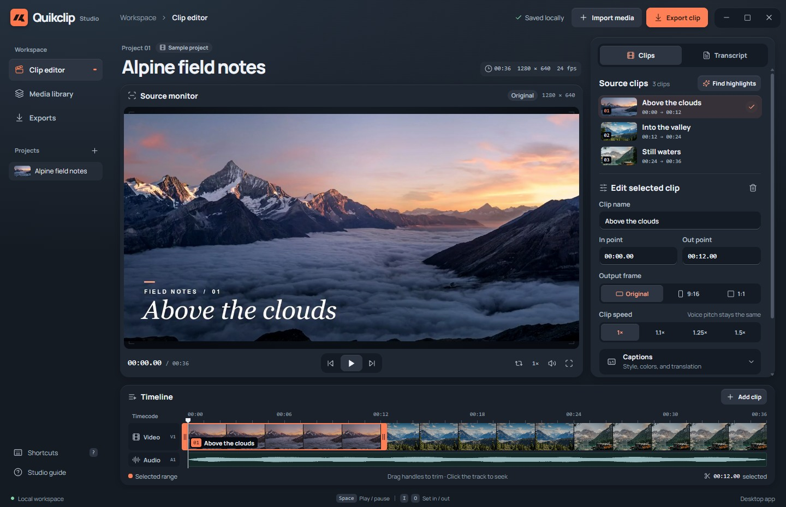

# Quikclip Studio

[](https://github.com/kerjakuyco/quikclip/actions/workflows/ci.yml)
[](LICENSE)
[](https://github.com/sponsors/kerjakuyco)

**Turn a long video into a short, shareable clip on your own machine.** Import a file or YouTube video, find highlights manually or with your choice of local or cloud AI, and export a landscape, square, or portrait cut.

Quikclip is an open-source desktop app built with Tauri 2, Rust, React, and TypeScript for Windows, macOS, and Linux. The bundled *Alpine field notes* project lets you try the editor immediately.



## Run the desktop app

**Installed app:** Open **Import media → YouTube URL**, paste a video link, and choose **Import video**. The installer includes yt-dlp, its JavaScript runtime, FFmpeg, and ffprobe. No separate downloader, Python installation, or `PATH` setup is needed.

**From source:** Install Node.js 22.12+ (or current LTS), stable Rust, and the [Tauri desktop prerequisites for your OS](https://v2.tauri.app/start/prerequisites/), then run:

```sh
git clone https://github.com/kerjakuyco/quikclip.git
cd quikclip
npm ci
npm run tauri dev
```

The first desktop build downloads and verifies pinned tools for the target. Later builds reuse the verified copies. Linux uses WebKitGTK 4.1, GStreamer H.264/AAC playback plugins, and (for saved API tokens) a Secret Service keyring.

## Edit a clip

- **Import media** opens a native file picker or accepts a YouTube watch, Shorts, or `youtu.be` URL. Desktop imports prepare a local editing copy with timeline thumbnails. The project opens as soon as that is done; the audio waveform is drawn in the background (about 25 seconds per hour of audio) and appears in the timeline when ready. The editing copy is capped at 1920 × 1080 and preserves the source aspect ratio. The original is untouched. Sources up to 12 hours are supported, and most import in seconds to a minute whatever their length, because nothing is re-encoded when it does not have to be:

  - Links download H.264 and AAC when the site offers them at the same resolution and frame rate.
  - H.264 sources, and HEVC, AV1, or VP9 sources that the app's player reports it can play, are copied into the project as they are (8-bit, up to 1080p, upright). Opus audio is kept when the player supports it; other audio is converted to AAC.
  - Anything else (10-bit, larger than 1080p, rotated, or a codec the player cannot play) is re-encoded to H.264, with a hardware encoder when one is available (NVENC, AMF, Quick Sync, or VideoToolbox). HDR phone footage (PQ or HLG) is tone-mapped to standard colour on the way, so it doesn't look grey and flat.

  Exports always re-encode just the clip, so a kept AV1 or HEVC original costs a little extra time per exported minute instead of a full re-encode at import.

- **More than one video per project.** The video menu beside the project's source badge switches between them, and **Add a video to this project** (or **Import media → Add to "project"**) brings in another file or link. Each clip cuts from its own video, which keeps its own transcript, waveform, and faces; removing an added video removes its clips and the copy Quikclip made.
- **Source clips** holds independent, named cuts. Search titles, suggestion notes, and spoken words, or filter by length on the ruler (0–30 s, 30–60 s, 60 s+), which marks where each clip's length falls. Fold the list away to give the clip's settings the room. **Add clip** starts a cut at the playhead. **Duplicate** copies the selected range and its settings, including captions, audio, and overlays. Edit either version independently; they share the underlying media files. Drag clips in the list (or press Alt + ↑ / ↓) to reorder them: a joined video plays them in this order. **Play in order** (also **Preview in order** in the join dialog) plays them back to back in the monitor, each with its own settings, between the opening shot and end card, with a flash where a transition will be.
- **Clip settings** sit in tabs under the clip's name and range: **Frame**, **Text**, **Audio**, **B-roll**, and **Post**. ‹ › steps between clips. A **Look** applies a frame, framing, captions, and polish in one press: Bold creator, Clean podcast, Karaoke pop, Quote card, or up to twenty of your own, and one can be the start for every new clip.
- **Timeline.** The video track shows every clip cut from the video (its numbered tab selects it) and hatches what the selected clip leaves out: pauses, ums, and words cut in the transcript. The **Layers** lane shows the clip's text and b-roll; drag one along, or use the arrow keys, to move it. Zoom around the playhead, use **Fit clip** to show the selected range, or choose **Full source** to reset the view. Drag the overview bar to pan, click the tracks to scrub, and drag the handles to trim. Zooming reuses the cached thumbnails and waveform. The magnet menu snaps handle edits and I/O shortcuts to **Frames** (when the frame rate is known) or **Words** (when a transcript is available). Word snapping stays free in long pauses. Hold Alt (Option on Mac) while dragging to bypass snapping, or enter exact in/out times in the inspector.
- **Output frame.** Choose Original, landscape 16:9, vertical 9:16, square 1:1, or feed portrait 4:5. **Fill the frame** crops; **Whole video** keeps the full picture on a blurred background; **Split: face on top** (vertical frames) puts a crop of the speaker over the whole picture; **Facecam + gameplay** (vertical frames, for streams) fills the top with your camera box, placed in a corner, sized, or framed around the face found, and the rest with the game. Framing is **By hand** (crop sliders), **Center**, **Follow faces** (the calm camera holds still for small moves and glides after a real one), or **Follow speaker** (switches to whoever's mouth is moving and holds through crosstalk); faces are found with the Windows face detector, or on macOS, Linux, and PCs without it, with the bundled SeetaFace detector. **Punch-in zooms** jump in on every other sentence. The monitor and exports use the same framing. **Safe areas** draws where TikTok, Reels, Shorts, feed posts, or YouTube cover a shaped frame. Use the loop control to review just the selection.
- **Transcript.** Every imported video is transcribed automatically once it opens, in the background: its audio goes to Whisper large v3 turbo on your connected OpenRouter or Cloudflare account, or to a Whisper server on this computer (any OpenAI-compatible one, such as faster-whisper-server or whisper.cpp's server: **Transcribe on this computer** takes its port and model), in 10-minute parts, three at a time, retried on network and rate-limit errors. Each part is kept as it arrives, so an interrupted run resumes where it stopped, and the finished transcript is stored with the project (`media/<id>/transcript.json`). The **Transcript** tab reads and searches it, follows playback, jumps to a clicked word, sets the clip's in and out with Shift+click, corrects misheard words (Edit words), and saves the transcript as text or the whole video's subtitles as .srt; corrections are kept with the project and reach every clip's captions. **Cut words** edits a clip by its text: click a word, or drag across several, to take them out; the preview skips them, the export cuts them, and the captions leave them out. Click or drag again to bring them back.
- **Captions** are on every clip automatically, cut from the transcript as ClipCheap cuts them: up to two lines of about 32 characters and 3 seconds, paced slightly ahead of the voice, in **Bold** (the spoken word lights up), **Clean**, **Boxed** (each line on a dark box), **Karaoke** (each word fills as it is spoken) or **Pop** (a few words at a time, the spoken one boxed), at the bottom, middle or top, nudged from the edge, in four sizes and twelve colours, or **Off**. **Keywords** light up wherever they are said, in the highlight colour and a little larger. **Edit this clip's lines** changes the burned-in wording for one clip, and **Reset to transcript** undoes it. A misheard word is corrected in the Transcript tab, where every clip follows it. Captions follow trims, cut-out pauses and speed, and are burned in on export in the clip's face: Noto Sans, Montserrat, Poppins, Bebas Neue, or Anton, all bundled (Korean, Japanese, and Chinese in the platform's regional face), with a matching .srt saved beside the clip.
- **Highlight finder** can look for up to 1, 3, 5, or 8 clips with a 30, 60, or 90 second length limit. As in ClipCheap, it reads numbered sentences from the transcript when available, looks for a hook and a payoff, and fits picks to whole sentences without sharing speech; a second read of the exact cuts keeps the ones that stand alone and end on a payoff, and writes each a hook line that becomes its headline. Videos without a usable transcript use nine frames instead. Select a suggested clip to read the AI's reason. Scores describe the proposed edit, not how a clip will perform.
- **Assistant.** Ask for edits in your own words ("make every clip vertical with Pop captions"), in the Assistant tab or straight from the command palette. It reads the clips and the transcript; each answer is a card listing what it changed (with **Show** to jump to a clip) and anything it skipped, and its changes are one step that **Undo these changes** takes back.
- **AI where you edit.** Sparkle buttons sit beside the fields they fill, using your Highlight finder model: **Suggest titles** by the clip name, **Suggest hooks** by the headline, **Suggest keywords** for the captions, **Suggest callouts** (short text on the video, added to the Layers lane), and **Tighten with AI** in the Transcript tab, which marks false starts, repeats, and rambling to cut one by one or all at once. The command palette runs the same actions.
- **Text on video.** Titles, subtitles, labels, quotes, and calls to action placed in nine spots, for a stretch of the clip, appearing with a fade, a pop, a slide, or typed out. The preview animates them as the export draws them.
- **B-roll.** Show other footage, from another video in the project or another moment of this one, over part of a clip: filling the frame or in a corner. The clip's sound keeps playing.
- **Audio.** **Clearer voice**, **Cut out pauses**, and **Cut ums and fillers** (from the transcript; captions drop the cut words too). **Export loudness** evens clips out to −16, −14, or −11 LUFS. Add your own background track with its own volume, start, loop, and fades, and let it **lower under speech**. The bed follows the finished clip's timing, including speed changes and removed pauses, in the preview and when exporting.
- **Post copy.** The Post tab writes a title, caption, and hashtags for TikTok, Reels, Shorts, X, and LinkedIn from what the clip says, in a friendly, professional, or bold tone, fitted to each platform's limits.
- **Export clip** renders the selected range to MP4 (H.264 and optional AAC). Choose the destination in the OS save dialog. On the desktop app, select more than one clip or frame to render up to 16 files into one new folder, or choose **One joined video** to play the selected clips in the order you set as one file, cut together or with a fade, dissolve, slide, wipe, or zoom, between an optional **opening shot** and **end card**. Renders go to a **render queue** in the status bar, one at a time with progress, so you keep editing while they run; cancel a waiting or running one there. Exports encode on the graphics card (NVIDIA NVENC, AMD AMF, Intel Quick Sync, or Apple VideoToolbox) when one works, falling back to the processor; **Encode on the graphics card** in the export dialog turns that off. Completed renders appear under **Exports**.
- **Command palette.** Ctrl+K (Cmd+K) finds any action, clip, look, video, or project by typing.
- **Jobs keep running.** An import, highlight search, or export keeps going when its dialog closes or the window reloads; the status bar shows it with its steps, progress, and **Cancel**, and an import that finishes while its window was away is added to your projects. Removing a clip, applying a look, and the AI's one-click edits say so in a toast with **Undo**. The inspector remembers its tab and settings tab.
- **Workspace** changes are saved locally. Media lives under the platform's app-local-data directory for `studio.quikclip.desktop`, in `media/<id>/`. The desktop app keeps projects, clips, and export history in `workspace.json` beside it, written atomically with the previous version kept as `workspace.backup.json`; the browser preview keeps them in local storage.

| Shortcut | Action |
| --- | --- |
| Space | Play or pause |
| J / K / L | Back 5 s / pause / forward 5 s |
| ← / → | Step backward / forward one frame |
| Shift + ← / → | Step one second |
| Home / End | Go to the clip's in / out point |
| I / O | Set in / out at the playhead |
| [ / ] | Previous / next clip |
| Ctrl or Cmd + D | Duplicate the clip |
| Delete | Remove the clip (the toast's **Undo** brings it back) |
| Alt or Option + ↑ / ↓ on a clip | Move it in the list |
| Ctrl or Cmd + E | Export clip |
| Ctrl or Cmd + scroll over the tracks | Zoom around the pointer |
| Shift + scroll over the tracks | Pan without seeking |
| ← / → on a trim handle | Move by 0.1 s, a frame, or a word boundary, depending on trim snapping |
| Alt or Option + drag a trim handle | Bypass snapping |
| M | Mute the monitor |
| Ctrl or Cmd + K | Command palette |
| Ctrl or Cmd + Z / Shift + Z | Undo / redo |
| ? | Show shortcuts |

## Connect an AI provider

In the desktop app, choose **Find highlights → provider → Connect & load models**. Select a vision model and click **Analyze source**. The studio remembers the model for each provider. **Edit connection**, **Refresh models**, and **Forget connection** are available in the same panel.

| Provider | Connection details | Model selection |
| --- | --- | --- |
| Ollama · local | Start Ollama on port `11434`, or enter its local port. Try `ollama pull gemma3:4b`. | Installed models advertising vision; cloud-backed models are excluded. |
| LM Studio · local | Start the server in the Developer tab (normally port `1234`). Enter a server token if authentication is enabled. | Locally served vision LLMs reported by `/api/v1/models`. |
| OpenRouter · cloud | Enter an [OpenRouter API key](https://openrouter.ai/settings/keys). | Live catalog of image-input, text-output chat models. |
| Cloudflare AI Gateway · cloud | Enter your account ID, gateway ID (`default` is supported), and an API token with **Account → Workers AI → Read**. | Discover Workers AI vision models, or choose **Other gateway model** and enter a supported `author/model` ID. See [Cloudflare's routing and billing guide](https://developers.cloudflare.com/ai-gateway/usage/rest-api/). |

Quikclip sends the transcript when it can, otherwise one nine-frame contact sheet and timestamps. It adds validated cuts up to the selected limit. Connecting or refreshing models doesn't send footage. Local providers use loopback; choosing a cloud provider sends the analysis input to that service, not the full video. Speech transcription sends audio separately as described above.

Tokens are stored in Windows Credential Manager, macOS Keychain, or Linux Secret Service. Project storage contains no API keys. `QUIKCLIP_MODEL` is still honored as the initial Ollama preference when that vision model is installed.

## Browser preview

```sh
npm run dev
```

Visit `http://127.0.0.1:1420`. The browser can play the sample, import browser-decodable local files, keep media in IndexedDB, edit cuts, and export WebM with WebCodecs and Mediabunny. YouTube downloads, AI analysis, and native MP4 rendering run in the desktop build.

## Packaging and checks

```sh
npm run tauri build
```

Build on the target OS to produce installers under `src-tauri/target/release/bundle/`. The **Desktop packages** workflow builds Windows x64, macOS, and Linux packages on native runners. These developer packages are unsigned. Media executables are shipped as namespaced Tauri sidecars; sources and notices are documented in [THIRD_PARTY_TOOLS.md](THIRD_PARTY_TOOLS.md). Local AI model weights are managed by your chosen provider.

```sh
npm run build
npx playwright install chromium
npm test
npm run prepare:tools
cargo test --manifest-path src-tauri/Cargo.toml --lib
```

The Playwright suite imports and plays a real video, checks zoomed trims and independent clip copies, and verifies the pixels in a cropped WebM; desktop flows (render queue, word cuts, AI suggestions, facecam) run against a mocked Tauri bridge. Use `PLAYWRIGHT_CHANNEL=msedge` to test with installed Microsoft Edge. Native tests cover URL and range validation, FFmpeg output duration, crop position, frame size, and audio, the caption scripts and every caption face's font selection, the GPU encoder fallback (and, on a computer with a graphics encoder, a real export on it at over 38 dB PSNR), the bundled face detector on a real portrait and on a moving one, the facecam layout against the sample film's own pixels, and a 31-minute recording transcribed in ten-minute parts. CI runs everything on Windows, and the native tests on macOS and Linux too.

On Windows, `node scripts/smoke-windows.mjs` verifies sample playback and native IPC in a packaged debug build using an isolated WebView2 profile.

## Project layout

- `src/` — editing workspace, source monitor, timeline, clip settings, local storage, browser media adapter.
- `src-tauri/src/media.rs` — native file dialogs, URL canonicalization, bounded media subprocesses, import and atomic export.
- `src-tauri/src/ai.rs`, `providers.rs` — contact sheet extraction, provider discovery and inference, native credential storage, and suggestion validation.
- `src-tauri/src/jobs.rs`, `renders.rs` — media jobs, and the render queue's renders with progress and cancellation.
- `src-tauri/src/suggest.rs`, `assistant.rs`, `post.rs` — the AI's suggestions in place, the editing assistant, and post copy.
- `src-tauri/src/faces.rs`, `src-tauri/models/` — face detection (Windows' detector, or the bundled SeetaFace model).
- `src-tauri/src/workspace.rs` — the desktop workspace file.
- `public/sample/` — bundled, offline sample film. Credits in [CREDITS.md](CREDITS.md).

## Contribute

Bug reports, patches, and feedback from editors on all three platforms are welcome. Start with the [contributing guide](CONTRIBUTING.md), [report a bug or propose a feature](https://github.com/kerjakuyco/quikclip/issues/new/choose), or read the [security reporting policy](SECURITY.md).

## Support Quikclip

If Quikclip is useful to you, [sponsor **@kerjakuyco** on GitHub](https://github.com/sponsors/kerjakuyco) to support its ongoing development. Sharing a reproducible issue or testing a build on your platform also helps.

## License

Quikclip's source code is licensed under the [GNU General Public License v3.0](LICENSE). See [credits](CREDITS.md) for the licenses of sample media, icons, and fonts.
